# Projeto Aplicado: Práticas de Mercado

**Aplicação web segura (Flask) em nuvem, com HTTPS pós-quântico e deploy automático via GitHub Actions**

Autora: Adriele da Silva Conceição
Curso: Pós-Graduação em Segurança da Informação e Análise Forense
Disciplina: Projeto Aplicado: Práticas de Mercado

Este repositório é o relatório técnico da entrega: contém o código-fonte, a documentação da infraestrutura e as evidências (prints em `docs/img/`). O projeto aplica os conceitos de *Secure by Design* e *Secure by Default* nos três eixos da disciplina, integrados por uma esteira de CI/CD.

- **Aplicação em produção:** https://projeto-aplicado-adriele.duckdns.org (IP público: `68.155.155.179`)
- **Credenciais de teste:** entregues ao professor pelo canal de entrega da disciplina. Por segurança, **não** estão neste repositório.

---

## Sumário

1. [Visão geral e arquitetura](#1-visão-geral-e-arquitetura)
2. [Eixo 1: Infraestrutura (Cloud)](#2-eixo-1-infraestrutura-cloud)
3. [Eixo 2: Repositório e GitHub](#3-eixo-2-repositório-e-github)
4. [Eixo 3: Aplicação e mitigações OWASP Top 10:2025](#4-eixo-3-aplicação-e-mitigações-owasp-top-102025)
5. [CI/CD com GitHub Actions](#5-cicd-com-github-actions)
6. [Como executar localmente](#6-como-executar-localmente)
7. [Problemas encontrados e soluções](#7-problemas-encontrados-e-soluções)
8. [Observações](#8-observações)
9. [Checklist de entrega](#9-checklist-de-entrega)
10. [Estrutura do repositório](#10-estrutura-do-repositório)

---

## 1. Visão geral e arquitetura

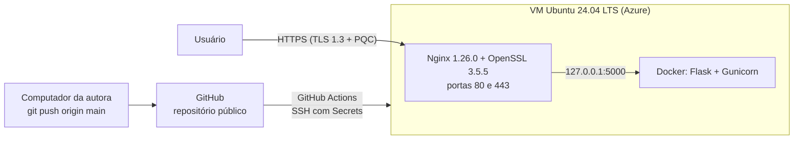

| Componente | Tecnologia |
|---|---|
| Nuvem | Microsoft Azure (VM Linux) |
| Sistema operacional | Ubuntu Server 24.04.5 LTS |
| Servidor web / proxy reverso | Nginx 1.26.0, compilado com OpenSSL 3.5.5 |
| Certificado | Let's Encrypt (ECDSA), Certbot 5.9.0 (snap) |
| Aplicação | Python, Flask 3.1.0, Gunicorn 23.0.0, Docker |
| CI/CD | GitHub Actions (deploy por SSH) |

---

## 2. Eixo 1: Infraestrutura (Cloud)

### 2.1 Servidor

A aplicação roda em uma máquina virtual na Azure (`servidor-flask-prod`) com **Ubuntu Server 24.04.5 LTS**. O Nginx do próprio servidor recebe o tráfego público e encaminha para o contêiner da aplicação, que escuta só em `127.0.0.1:5000`.

### 2.2 Nginx com OpenSSL 3.5.5 (suporte a criptografia pós-quântica)

Para obter o suporte a **PQC** (troca de chaves híbrida pós-quântica), o Nginx foi **compilado a partir do código-fonte** com o OpenSSL 3.5.5, que traz ML-KEM nativo. A versão anterior (OpenSSL 3.4.0) não oferecia o grupo híbrido `X25519MLKEM768`.

```bash
./configure --with-http_ssl_module --with-openssl=/home/azureuser/openssl-3.5.5
make
```

Trecho da configuração de produção (`/usr/local/nginx/conf/nginx.conf`):

```nginx
# Porta 80: validação do Certbot e redirecionamento para HTTPS
server {
    listen       80;
    server_name  projeto-aplicado-adriele.duckdns.org 68.155.155.179;

    location /.well-known/acme-challenge/ {
        root /var/www/certbot;
    }
    location / {
        return 301 https://projeto-aplicado-adriele.duckdns.org$request_uri;
    }
}

# Porta 443: TLS 1.2/1.3, curva híbrida pós-quântica e proxy para o Flask
server {
    listen       443 ssl;
    server_name  projeto-aplicado-adriele.duckdns.org;

    ssl_certificate      /etc/letsencrypt/live/projeto-aplicado-adriele.duckdns.org/fullchain.pem;
    ssl_certificate_key  /etc/letsencrypt/live/projeto-aplicado-adriele.duckdns.org/privkey.pem;

    ssl_protocols    TLSv1.2 TLSv1.3;
    ssl_ecdh_curve   X25519MLKEM768:X25519:secp384r1;

    location / {
        proxy_pass http://127.0.0.1:5000;
        proxy_set_header Host $host;
        proxy_set_header X-Real-IP $remote_addr;
        proxy_set_header X-Forwarded-For $proxy_add_x_forwarded_for;
        proxy_set_header X-Forwarded-Proto $scheme;
    }
}
```

**Evidência:** o Nginx está ligado ao OpenSSL 3.5.5.

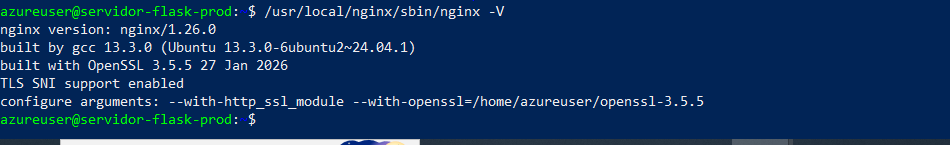

### 2.3 HTTPS com Certbot e renovação automática

- **Certbot 5.9.0**, instalado pelo `snap` (versão mínima exigida: 5.4).
- Certificado **Let's Encrypt (ECDSA)**, emitido pelo método `webroot`, válido até **29/01/2027**.
- **Autorrenovação** pelo timer do snap (`snap.certbot.renew.timer`), com `--deploy-hook` que recarrega o Nginx (`nginx -s reload`) a cada renovação.
- Teste da renovação (`certbot renew --dry-run`): sucesso.

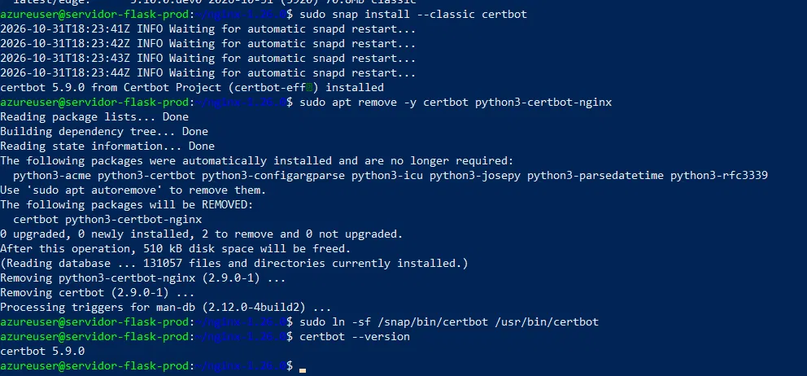

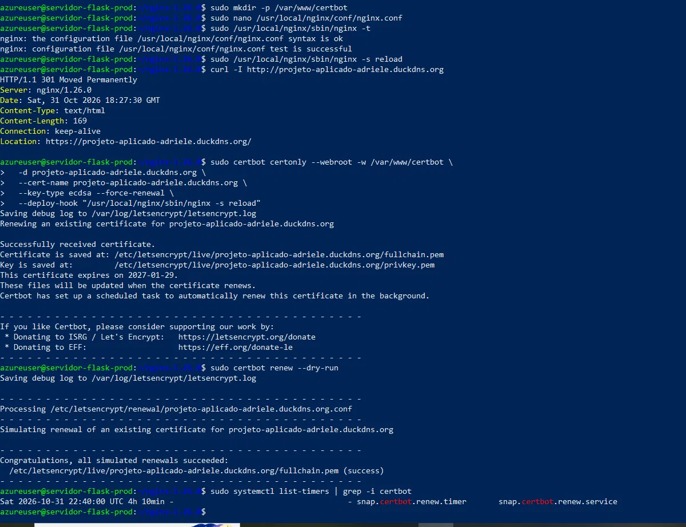

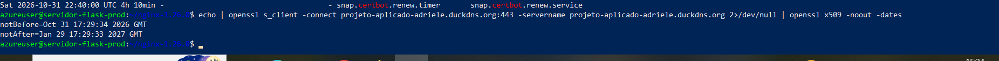

### 2.4 Redirecionamento automático de HTTP para HTTPS

Todo acesso na porta 80 recebe `301 Moved Permanently` para o HTTPS.

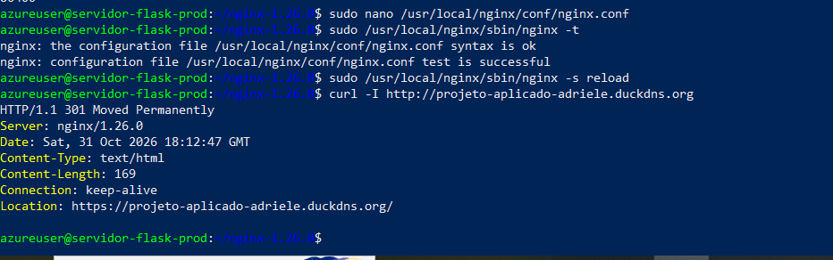

### 2.5 Qualys SSL Labs: nota A e suporte a PQC

O teste do Qualys SSL Labs (31/10/2026) retornou **nota A**, com **TLS 1.3** e a mensagem *"This server supports PQC (Post-Quantum Cryptography) key exchange"*.

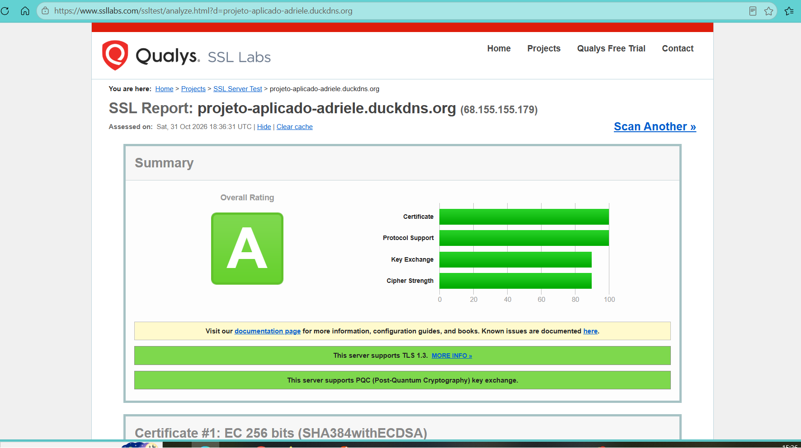

### 2.6 Acesso remoto seguro (SSH apenas com chave)

Configuração efetiva do `sshd` (`sshd -T`):

| Parâmetro | Valor |
|---|---|
| `PasswordAuthentication` | `no` |
| `PubkeyAuthentication` | `yes` |
| `PermitRootLogin` | `no` |

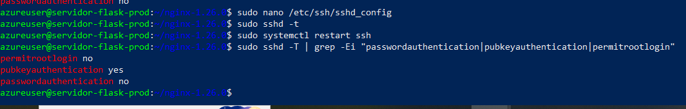

Teste de que a senha é recusada (tentativa de login forçando senha):

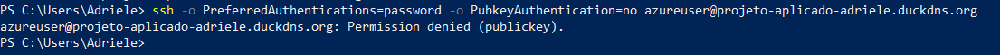

### 2.7 Fail2Ban na porta 22

Jail `sshd` ativa, com **4 tentativas erradas** (`maxretry = 4`) e **banimento de 24 horas** (`bantime = 24h`, ou 86400 s). No momento do teste, o serviço já havia banido 2 IPs externos.

```ini
[sshd]
enabled  = true
port     = ssh
maxretry = 4
bantime  = 24h
```

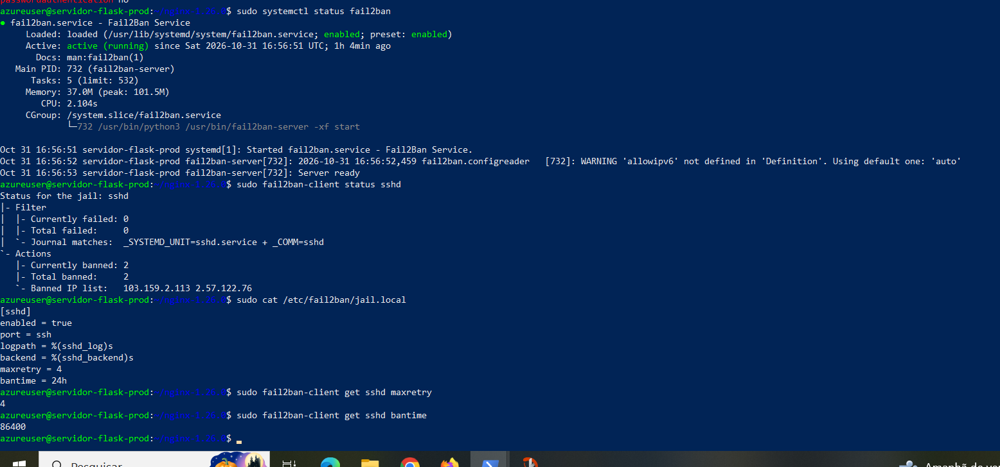

### 2.8 Firewall (Network Security Group da Azure): menor privilégio

Apenas as portas necessárias ficam abertas para entrada: **22** (SSH), **80** (HTTP, usado no redirecionamento e na validação do certificado) e **443** (HTTPS). A porta **5000** (Flask) **não** é exposta: a regra foi removida e o contêiner é publicado só em `127.0.0.1`.

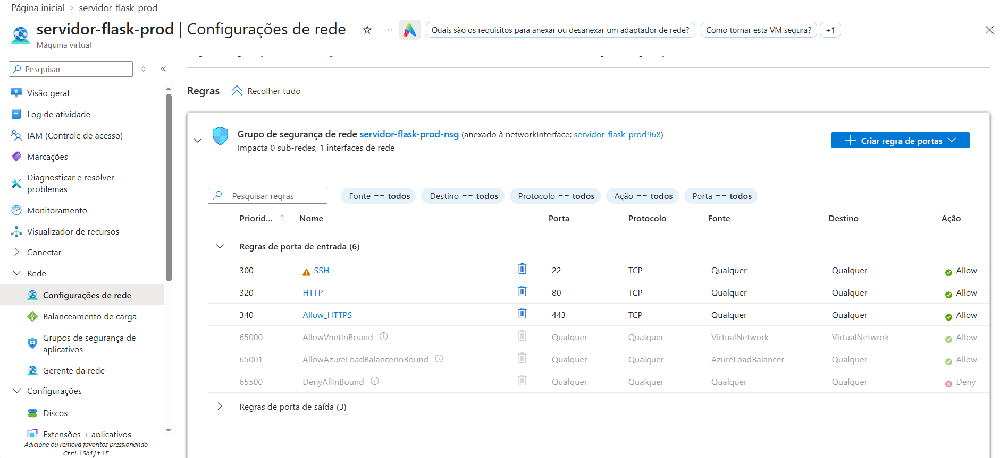

Teste a partir de fora: a conexão na porta 5000 falha (`TcpTestSucceeded : False`).

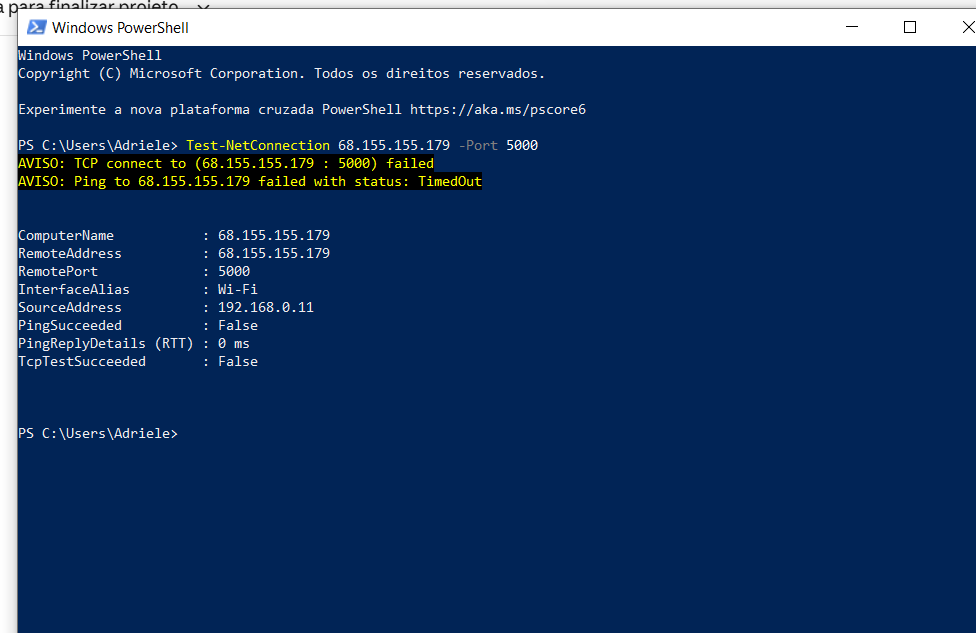

> A origem da regra SSH está como "Qualquer" porque o acesso é protegido por chave (senha desabilitada) e pelo Fail2Ban, e o GitHub Actions precisa alcançar o SSH usando endereços IP que variam.

---

## 3. Eixo 2: Repositório e GitHub

- **Plataforma:** GitHub, repositório **público**.
- **Autenticação em duas etapas (2FA):** ativada na conta, com aplicativo autenticador.
- **`.gitignore`:** bloqueia `.env` e `.env.*`, chaves privadas (`*.pem`, `*.key`, `*.p12`, `id_rsa*`, `id_ed25519*`), bancos locais (`*.db`, `*.sqlite`, `*.sqlite3`), `__pycache__/` e ambientes virtuais.
- **`.dockerignore`:** impede que `.env`, chaves, `.git` e `.github` entrem na imagem Docker.
- **Segredos:** nenhuma senha, chave ou token está versionado. As credenciais de produção ficam em um arquivo `.env` **somente no servidor** (permissão `600`), e as da pipeline ficam nos **GitHub Secrets**.

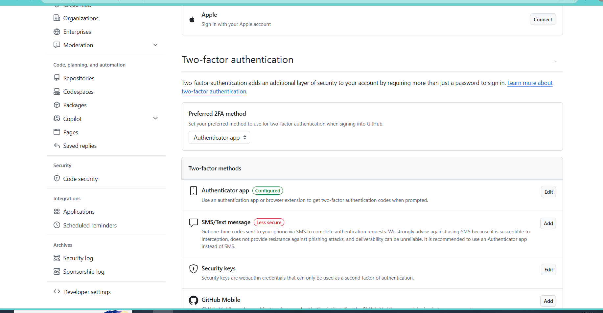

---

## 4. Eixo 3: Aplicação e mitigações OWASP Top 10:2025

### 4.1 O protótipo

Aplicação Flask com a estrutura mínima exigida:

| Rota | Função |
|---|---|
| `/login` | Tela de login (GET e POST) |
| `/dashboard` | Página interna, **somente** para usuário autenticado |
| `/logout` | Encerra a sessão e volta ao login |

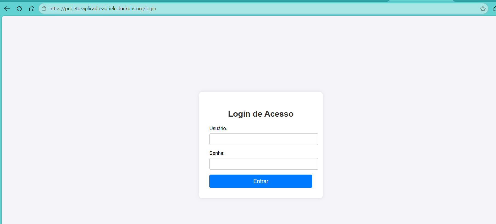

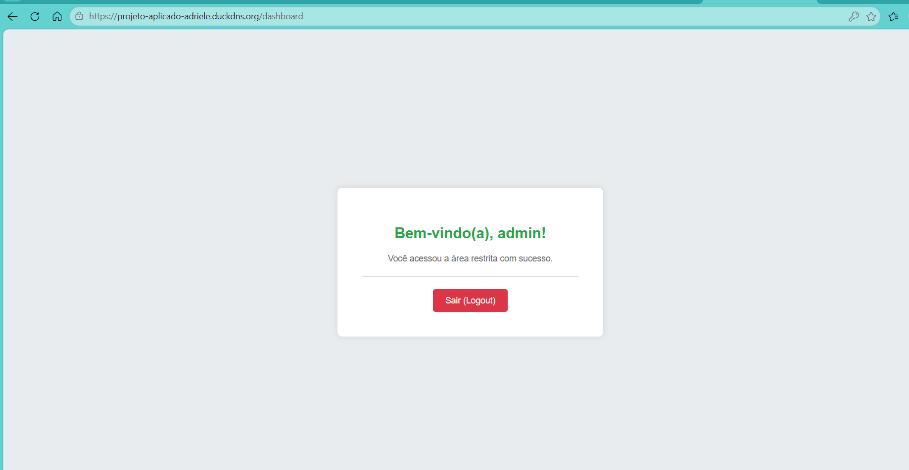

### 4.2 As 3 categorias da OWASP Top 10:2025 mitigadas

Referência: [OWASP Top 10:2025](https://owasp.org/Top10/2025/). Todo o código descrito está em `app.py`.

#### A07:2025 Authentication Failures (Falhas de Autenticação)

- **O que é:** falhas na autenticação ou no gerenciamento de sessão que permitem a um atacante se passar por um usuário legítimo (força bruta, enumeração de usuários, credenciais fracas, sessões mal protegidas).
- **Como foi mitigado:**
  - **Senha só como hash** (scrypt, via Werkzeug): `check_password_hash(SENHA_HASH, senha)` na função `credenciais_validas`. Não há senha em texto puro em nenhum lugar.
  - **Mensagem de erro genérica** (`"Credenciais inválidas!"`), sem revelar se o usuário ou a senha estava errado. A comparação do usuário usa `hmac.compare_digest`, e o hash é sempre verificado, para o tempo de resposta ser parecido nos dois casos.
  - **Limite de tentativas por IP:** 5 falhas em 5 minutos bloqueiam novas tentativas com HTTP `429` (funções `_ip_bloqueado` e `_registrar_falha`).
  - **Sessão segura:** `session.clear()` a cada login (nova sessão), cookie com `HttpOnly`, `Secure` e `SameSite=Lax`, expiração em 30 minutos.
  - **Limite de tamanho** de 128 caracteres nos campos do formulário.
- **Evidências:** bloqueio por tentativas (abaixo) e senha antiga recusada em produção.

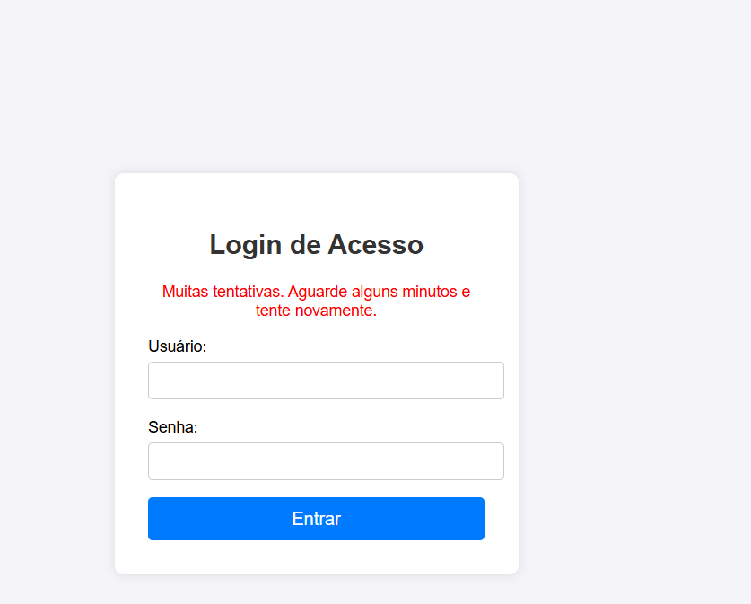

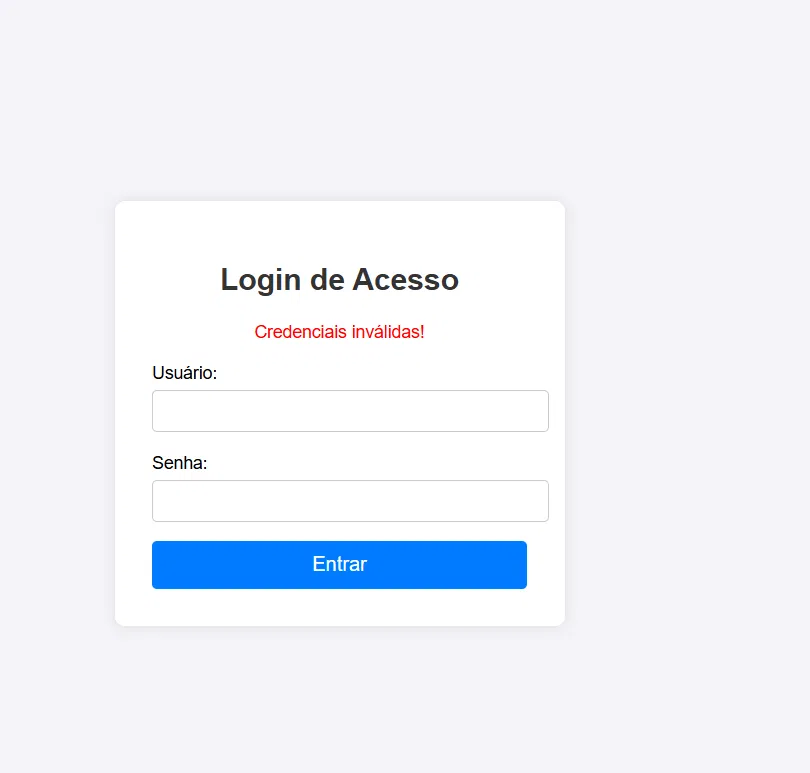

#### A01:2025 Broken Access Control (Controle de Acesso Quebrado)

- **O que é:** restrições sobre o que cada usuário pode acessar não são aplicadas corretamente, permitindo acesso a áreas ou ações não autorizadas.
- **Como foi mitigado:**
  - O decorador `@login_obrigatorio` protege `/dashboard`: sem sessão válida, a resposta é um redirecionamento (`302`) para `/login`.
  - O `logout` usa `session.clear()`, encerrando a sessão por completo.
  - Todas as respostas saem com `Cache-Control: no-store`, para que o botão "voltar" do navegador não reexiba o painel depois do logout.
- **Evidência (log do teste local):** após o logout, o pedido do navegador ao `/dashboard` recebe `302` e volta ao login. Também aparecem as falhas de login, o bloqueio `429` e o acesso ao `/dashboard` sem sessão.

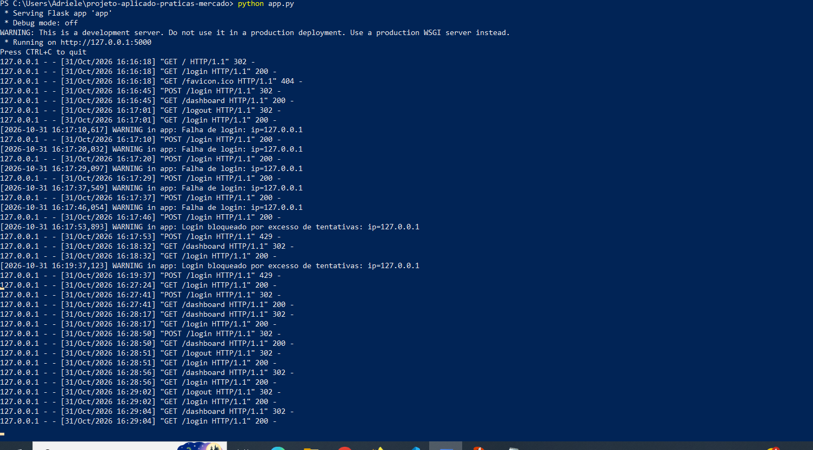

#### A02:2025 Security Misconfiguration (Configuração Incorreta de Segurança)

- **O que é:** sistemas com configurações inseguras, padrões inseguros, segredos expostos ou recursos desnecessários habilitados.
- **Como foi mitigado:**
  - **Nenhum segredo no código:** usuário (`APP_USER`), hash da senha (`APP_PASSWORD_HASH`) e `SECRET_KEY` vêm de variáveis de ambiente, **sem valor padrão**. Se alguma faltar, a aplicação se recusa a iniciar (função `_variavel_obrigatoria`).
  - **Modo de depuração desligado** (`debug=False`) e servidor de produção com Gunicorn.
  - **Cabeçalhos de segurança** em todas as respostas: `Content-Security-Policy`, `X-Frame-Options: DENY`, `X-Content-Type-Options: nosniff`, `Referrer-Policy: no-referrer`.
  - **Limite de tamanho** das requisições (16 KB).
  - **Exposição mínima:** o contêiner é publicado apenas em `127.0.0.1:5000`; o `.env` não é versionado nem entra na imagem Docker.
- **Evidência:** cabeçalhos de segurança retornados em produção e porta publicada só no loopback.

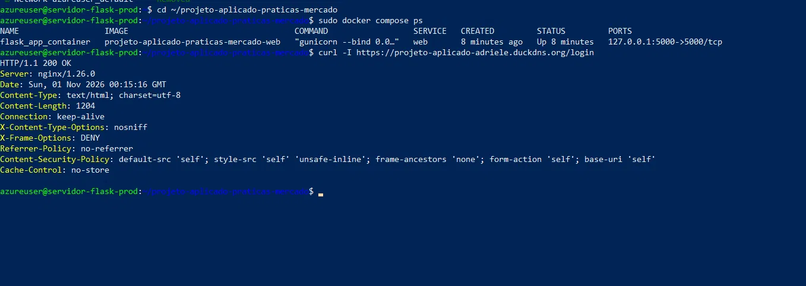

---

## 5. CI/CD com GitHub Actions

O workflow (`.github/workflows/deploy.yml`) é disparado a cada `git push origin main` e executa:

1. **Checkout** do código.
2. **Configuração do SSH** usando os Secrets do GitHub, com `known_hosts` fixado (a identidade do servidor é verificada).
3. **Deploy no servidor:** atualiza o código (`git fetch` e `git reset --hard origin/main`) e reconstrói o contêiner (`docker compose up -d --build --remove-orphans`).
4. **Verificação:** requisição HTTPS à aplicação, com novas tentativas, para confirmar que subiu.

**Boas práticas aplicadas:**

- Credenciais apenas em **GitHub Secrets**: `SSH_PRIVATE_KEY`, `SSH_KNOWN_HOSTS`, `SSH_HOST` e `SSH_USER`. Nenhuma credencial no arquivo `.yml`.
- **Chave SSH exclusiva para o deploy** (ed25519, separada da chave de administração). A chave privada existe apenas nos Secrets e foi removida do servidor; no servidor fica só a chave pública.
- Permissões mínimas do workflow (`contents: read`) e uma única action de terceiros (`actions/checkout`).
- Trava de concorrência: nunca dois deploys ao mesmo tempo.

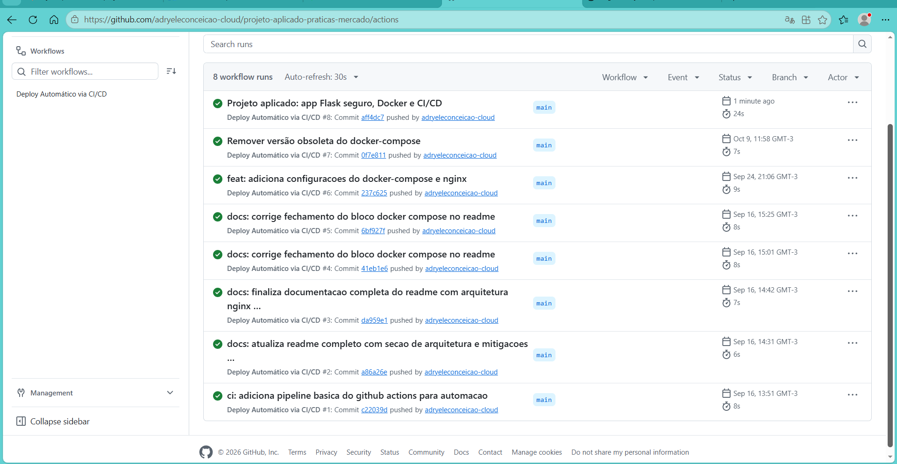

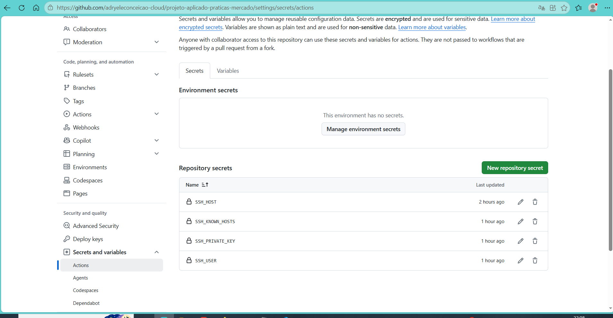

---

## 6. Como executar localmente

### Pré-requisitos

- Docker e Docker Compose **ou** Python 3.11+.

### 1. Clonar o repositório

```bash
git clone https://github.com/adryeleconceicao-cloud/projeto-aplicado-praticas-mercado.git
cd projeto-aplicado-praticas-mercado
```

### 2. Gerar o hash da senha e a chave secreta

```bash
python -c "import getpass; from werkzeug.security import generate_password_hash; print(generate_password_hash(getpass.getpass('Senha: ')))"
python -c "import secrets; print(secrets.token_hex(32))"
```

### 3. Criar o arquivo `.env` (não versionado)

Use **aspas simples** nos valores: o hash contém o caractere `$`, que o Docker Compose trataria como variável.

```
SECRET_KEY='<chave-gerada-acima>'
APP_USER='admin'
APP_PASSWORD_HASH='<hash-gerado-acima>'
COOKIE_SECURE='false'
```

`COOKIE_SECURE='false'` serve apenas para testar em HTTP local. Em produção (HTTPS), o padrão é `true`.

### 4. Subir a aplicação

Com Docker:

```bash
docker compose up --build -d
```

Sem Docker (defina as mesmas variáveis no ambiente e rode):

```bash
python app.py
```

Acesse `http://127.0.0.1:5000/login`.

---

## 7. Problemas encontrados e soluções

| Problema | Causa | Solução |
|---|---|---|
| O SSL Labs não mostrava suporte a PQC | O Nginx estava ligado ao OpenSSL 3.4.0, sem ML-KEM | Recompilação do Nginx com OpenSSL 3.5.5 e `ssl_ecdh_curve X25519MLKEM768:X25519:secp384r1` |
| A renovação automática do certificado falhava (`Address already in use`) | Certbot 2.9.0 (apt) com plugin `nginx` esperando um Nginx instalado pelo sistema, e não o compilado em `/usr/local/nginx` | Certbot 5.9.0 pelo snap, método `webroot` e `--deploy-hook` para recarregar o Nginx |
| Porta 5000 acessível da internet | Regra do NSG e contêiner publicado em `0.0.0.0` | Regra removida e porta publicada só em `127.0.0.1` |
| Credenciais de desenvolvimento no código | Versão inicial do protótipo | Migração para variáveis de ambiente com hash de senha; valores de produção renovados |
| Deploy automático inexistente | O workflow original só fazia checkout e `echo` | Pipeline com SSH, Secrets, chave de deploy exclusiva e verificação final |

---

## 8. Observações

- **Domínio e IP:** o certificado foi emitido para o domínio gratuito `projeto-aplicado-adriele.duckdns.org`. Quem acessa `http://68.155.155.179` é redirecionado para o domínio em HTTPS. A emissão de certificado diretamente para o endereço IP (recurso do Certbot 5.4+) não foi utilizada.
- **`nginx.conf` do repositório:** é uma cópia da configuração de produção do Nginx (seção 2.2), versionada para documentação. Contém apenas caminhos de certificados, sem chaves nem senhas. No servidor, o arquivo fica em `/usr/local/nginx/conf/nginx.conf`.
- **Evolução possível:** adicionar token anti-CSRF, trocar o `logout` por requisição `POST`, habilitar HSTS no Nginx e executar o contêiner com usuário sem privilégios.

---

## 9. Checklist de entrega

| Requisito | Situação | Evidência |
|---|---|---|
| Aplicação no ar com IP público | Atendido | Seção 1 |
| HTTPS com Certbot 5.4+ e autorrenovação | Atendido (5.9.0, `webroot`) | 08, 08b, 08c |
| Redirecionamento HTTP para HTTPS | Atendido | 07 |
| Qualys SSL Labs: nota A e PQC | Atendido | 02 |
| SSH só por chave, sem senha | Atendido | 03, 04 |
| Fail2Ban: 4 erros e 24 h na porta 22 | Atendido | 05 |
| Firewall com portas mínimas | Atendido (22, 80, 443) | 06, 06b |
| Repositório público e `.gitignore` | Atendido | Seção 3 |
| 2FA na conta do GitHub | Atendido | 14 |
| Login, página interna e logout | Atendido | 09, 10 |
| 3 categorias OWASP Top 10:2025 documentadas | Atendido (A07, A01, A02) | Seção 4.2 |
| CI/CD com GitHub Actions e Secrets | Atendido | 12, 13 |

---

## 10. Estrutura do repositório

```
.
├── .github/workflows/deploy.yml   # pipeline de CI/CD
├── docs/img/                      # evidências (prints) usadas neste relatório
├── templates/
│   ├── login.html
│   └── dashboard.html
├── app.py                         # aplicação Flask com as mitigações OWASP
├── Dockerfile
├── docker-compose.yml             # lê o .env e publica em 127.0.0.1:5000
├── nginx.conf                     # configuração do Nginx de produção (cópia)
├── requirements.txt
├── .dockerignore
├── .gitignore
└── README.md
```